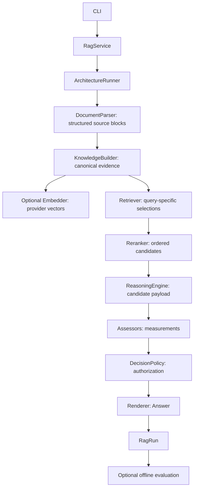

# Baseline 0 architecture

Baseline 0 moves the reference extraction behavior into independently replaceable
components. Composition is selected by YAML identifiers; no code branches on the
architecture name. The application owns invocation, the runner owns sequencing,
and components receive only the inputs relevant to their stage.

## Execution and boundaries



| Boundary | Contract and baseline implementation |
| --- | --- |
| Parsing | `DocumentParser` → `PyMuPDFDocumentParser`: reads local PDFs and returns individual nonempty text blocks. |
| Knowledge | `KnowledgeBuilder` → `BasicKnowledgeBuilder`: maps eligible source elements to in-memory evidence. |
| Embedding | `Embedder` → `OpenAICompatibleEmbedder`: optional batched `/embeddings` requests; the baseline full-document retriever does not construct it. |
| Retrieval | `Retriever` → `FullDocumentRetriever`: returns all eligible TEXT evidence in source order, independent of the query. |
| Reranking | `Reranker` → `IdentityReranker`, `TopKReranker`, or lazy `CrossEncoderReranker`; the latter scores local query/candidate pairs. |
| Reasoning | `ReasoningEngine` → `BasicSummaryReasoner`: produces a structured keyword/summary proposal through an injected model client. |
| Assessment | `Assessor` → `NoOpAssessor`: returns no measurements, with no implicit pass score. |
| Decision | `DecisionPolicy` → `AcceptAllDecisionPolicy`: accepts the candidate unchanged. |
| Rendering | `Renderer` → `BasicSummaryRenderer`: checks the accepted payload and formats an `Answer`; makes no model call. |
| Evaluation | `Evaluator` → `BasicPipelineEvaluator`: checks terminal-run completion and baseline schema validity outside normal execution. |
| Model I/O | `StructuredModelClient` → `AqueductModelClient`: requests a caller-supplied Pydantic schema using PydanticAI. |

Each protocol module documents its inputs, outputs, invariants, I/O expectations,
and error contract. Constructor injection keeps vendor clients out of semantic
requests. Domain modules depend only on the standard library. The concrete parser
contains PyMuPDF calls; the model adapter contains PydanticAI and OpenAI provider
construction. Pydantic is used at configuration and structured-output boundaries.

The optional architecture-level `embedder` component is configured in YAML with a
provider type, nested model settings, and an optional batch size. The current
`openai_compatible` implementation uses the shared Aqueduct credential resolver
and the existing `Embedder` protocol. It is lazy with respect to client creation;
full-document retrieval therefore remains usable without embedding credentials.
Index-building workflows continue to use the separate ingestion embedding
configuration, whose explicit dimension is part of the persisted vector-index
identity.

### Source versus knowledge

`DocumentSource` identifies a local source by ID and path. `ParsedDocument` contains
`DocumentElement` records, page count, and a SHA-256 input digest. The parser
preserves text, one-based page numbers, zero-based original block indices,
document-wide reading-order indices, and bounding boxes in PDF points.

Blocks are sorted by `(y // 10 * 10, x)` within each page. The parser does not
flatten them, build evidence, or know about prompts. Its positional heuristic may
misorder complex columns. Empty, corrupt, encrypted, and textless PDFs fail clearly;
OCR is unavailable. PyMuPDF extraction runs synchronously because that library is
not safe for concurrent thread-based parsing. The async protocol keeps I/O-capable
alternative parsers interchangeable; Baseline 0 introduces no parallel parsing.

`KnowledgeBase` contains `EvidenceUnit` records created by the knowledge builder.
TEXT, TABLE, FIGURE, EQUATION, and CAPTION are representable, and text is optional
for nontext evidence. Only TEXT is produced by this baseline. Evidence is frozen,
and its string-valued metadata is copied into a read-only mapping. IDs are derived
from document ID, page, block, and modality. The service derives document IDs from
resolved source URIs; content digests distinguish revisions of that source.

### Source state versus query state

`EvidenceUnit` has no score or rank. `RetrievalResult` associates canonical evidence
with a one-based rank, optional score, retriever ID, query variant, and metadata.
It lives in `domain/evidence.py` because run records and several subsystems retain
it. `RetrievalRequest` and `RetrievalResponse` remain retrieval-local envelopes.
Source ordering is document ID, known page number, reading order, then evidence ID;
the single-document baseline therefore follows parser order. Full-document
selection is intentionally not semantic retrieval.

### Proposal, judgment, authorization, and presentation

`ReasoningRequest` carries a task and selected evidence. The reasoner joins text
only at prompt construction. Shared `ReasoningResult` contains JSON-compatible
architecture-specific payload, optional claims, and metadata. The baseline's typed
`BasicSummaryPayload` is owned by `reasoning/basic_summary.py`, then serialized into
the shared candidate record. The renderer validates that schema again at its
boundary. Shared results live in domain so `RagRun` does not import a subsystem.

`Claim` provides an ID, text, and evidence references for future use; Baseline 0
returns no claims. `Assessment` identifies a target, assessor, dimension, optional
score/label, evidence references, and metadata. Empty assessments mean no judgment.
`DecisionResult` records ACCEPT, REJECT, or ABSTAIN independently of measurements.
The baseline renderer only handles ACCEPT and raises for unsupported actions.
Future policies and compatible renderers can provide rejection/abstention output.
`Answer` carries rendered text, structured payload, optional claims/references,
and metadata. Its baseline `verified: false` marker makes the limitation explicit.

### Assessment versus evaluation

Assessment is a production stage. Evaluation consumes terminal `RagRun` records
without changing their answers or acceptance decisions. `TestCase`, `TestSuite`,
`MetricResult`, and `CaseEvaluation` describe small experiments. `EvaluationRunner`
executes cases and retains failed runs rather than stopping at the first component
failure. `BasicPipelineEvaluator` measures only pipeline success and output shape;
it provides no scientific evidence of grounding or summary quality. Evaluation is
never required by the CLI or service.

## Runtime, configuration, and failures

`Architecture` holds the eight component categories, including a tuple of
independent assessors. `ComponentRegistry` uses typed, stage-local factory maps.
It validates every name before constructing a model adapter and accepts an injected
generation client for tests. Register alternatives by updating the corresponding
typed map; there is no import-by-string plugin loader.

`ArchitectureRunner` is linear. That restriction belongs to this execution strategy,
not the component protocols. Later strategies can retrieve or reason repeatedly,
compose assessors, or introduce concurrency without changing those contracts.
`RunContext` owns a fresh run ID, architecture identity, UTC start time, elapsed
clock, trace, and runtime metadata. Semantic input stays in `RagRequest`.

`RagRun` retains the original request, identity/version, retrieval output/history,
reasoning output, assessments, decision, answer, metadata, timestamps, and trace.
Stage events are appended on start and completion/failure. Failed components raise
`RunFailedError` with a partial `.run` and chained original exception. Persisted
messages include only stage and exception type, not raw provider bodies. Invalid
application inputs/configuration fail before a run starts. Cancellation interrupts
execution and propagates; it is not converted to a successful or completed run.
No artifact storage or distributed tracing is introduced.

Architecture YAML uses typed Pydantic models with unknown fields forbidden.
Unknown stage identifiers fail in the registry. Model settings validate provider,
HTTP URL, nonempty name, retry bounds, and timeout bounds. URLs cannot contain
userinfo, query tokens, or fragments. Secrets must be supplied through the
environment or key file, never through YAML. Configuration errors report failing
field locations without printing their input values.

The Aqueduct adapter resolves a nonempty `AQUEDUCT_API_KEY` first, then reads and
strips a UTF-8 `AQUEDUCT_API_KEY_FILE`. Empty/missing/unreadable credentials raise
an error. Each generation owns an async SDK client that is closed on success and
failure. Configured retries apply independently to HTTP transient errors and
PydanticAI output repair. The default is two retries of each kind, bounded by an
overall 120-second deadline. Permanent HTTP errors follow SDK behavior and are
not retried (401 is covered by a transport test). No retry loops are added in the
reasoner or orchestrator.

## Prompt and reproducibility

| Property | Baseline contract |
| --- | --- |
| Prompt ID/version | `basic-summary` / `1.0` |
| Input | All selected nonempty text in deterministic source order plus user task |
| Output schema | `BasicSummaryPayload` |
| Keyword validation | List of 5–8 strings |
| Keyword instruction | Topic keywords or short phrases, 1–3 words each |
| Summary validation | 20–500 characters |
| Summary instruction | 2–3 sentences describing the paper's main contribution |
| Grounding behavior | Prompt asks for source-supported extraction; no verification is performed |
| Evaluation relationship | Structural schema checks only; quality evaluation is future work |

The small versioned prompt remains beside the single reasoner rather than creating
an unused prompt-loading framework. Model/provider/base URL and retry/deadline
defaults live in the YAML. Sampling and token limits are left to provider defaults,
matching the reference behavior; they are not deterministic guarantees. No input
truncation is performed. Papers exceeding provider limits fail rather than silently
changing the baseline.

Runs retain effective architecture configuration, package version, source digest,
selected evidence IDs, and prompt/schema identity. `uv.lock` records library
versions. Record the Git commit with experimental artifacts; package version alone
does not identify uncommitted source changes. Remote model aliases and provider
defaults can change, so bit-for-bit reproduction is not promised.

## Reference script migration

The reference `../example_basic_extraction.py` was outside the Git repository; it
was inspected but is not imported, copied, or invoked by the new package. The
repository has no separate extraction script or alternate execution path.

| Reference responsibility | New owner |
| --- | --- |
| PDF validation | `application/service.py`, with content validation in the parser |
| PyMuPDF block extraction and positional sorting | `parsing/pymupdf.py` |
| Whole-document material sent to the model | Knowledge builder, full-document retriever, then reasoner concatenation |
| Extraction schema and prompt | `reasoning/basic_summary.py` |
| Provider/client/agent construction | `infrastructure/llm/aqueduct.py` |
| Environment/key-file resolution | `infrastructure/llm/credentials.py` |
| Model and endpoint defaults | `configs/architectures/baseline_v0.yaml` |
| Keyword/summary formatting | `rendering/basic_summary.py` |
| Terminal output | `application/cli.py` |
| Execution sequence | `orchestration/runner.py` |

The reference's hard-coded-key shortcut was intentionally not migrated. The
environment/key-file resolver is the only credential path. Empty key files now
fail explicitly. Format and sentence/word-count semantics otherwise follow the
reference's relevant extraction behavior.

## File map

Every Python package also includes a documented `__init__.py`.

```text
src/llm_grounding/
├── __main__.py
├── domain/
│   ├── documents.py
│   ├── evidence.py
│   ├── claims.py
│   ├── answers.py
│   └── runs.py
├── parsing/             protocol.py, pymupdf.py
├── knowledge/           protocol.py, models.py, basic.py
├── retrieval/
│   ├── protocol.py
│   ├── models.py
│   ├── full_document.py
│   └── reranking/       protocol.py, identity.py, top_k.py, cross_encoder.py
├── reasoning/           protocol.py, models.py, basic_summary.py
├── assessment/          protocol.py, noop.py
├── decision/            protocol.py, accept_all.py
├── rendering/           protocol.py, basic_summary.py
├── evaluation/          protocol.py, models.py, runner.py, basic.py
├── orchestration/       architecture.py, registry.py, runner.py, context.py
├── infrastructure/
│   ├── config/          models.py, loader.py
│   └── llm/             protocol.py, aqueduct.py, credentials.py
└── application/         service.py, cli.py
configs/architectures/baseline_v0.yaml
tests/
├── conftest.py
├── unit/
│   ├── test_source_pipeline.py
│   ├── test_configuration.py
│   ├── test_credentials.py
│   ├── test_reasoning.py
│   └── test_aqueduct.py
└── integration/
    ├── test_baseline.py
    └── test_aqueduct_transport.py
pyproject.toml
uv.lock
.gitignore
.env.example
README.md
docs/architecture.md
```

`README.md` replaces the initial GitLab template. All implementation, configuration,
and test files are new; repository guidelines remain unchanged. No storage package
is added because the baseline needs no persistence adapter.

## Next phase

Deliberate future work includes scientific test cases and quality metrics,
substantive assessors, claim-aware policies, and additional parser/evidence
modalities. Cross-encoder reranking is selection support only; it does not verify
claim entailment or factual correctness.

## Evaluation and observability boundary

The `observability` package is the provider-neutral boundary for the native
`/eval/v1` adapter. `RagRunObservation` is serialized for HTTP responses,
diagnostics, and durable replay. `ObservationBuilder` maps existing runtime
answers, assessments, decisions, and retrieval results; it does not perform
network I/O or semantic judging.

Basic RAG emits two comparable retrieval snapshots: candidate retrieval and the
final context passed to the reasoner. Each item retains its canonical chunk ID,
one-based rank, score type, and evidence references. `TraceRecorder` supplies
nested monotonic durations while preserving wall-clock timestamps. The model
client returns `GenerationResult`, which keeps validated output together with
provider-reported usage and model identity.

Observations are persisted separately from run metadata in
`rag_run_observations`, keyed by both `run_id` and unique `request_id`. This
allows evaluation clients to recover and re-score completed executions without
running the target pipeline again.
